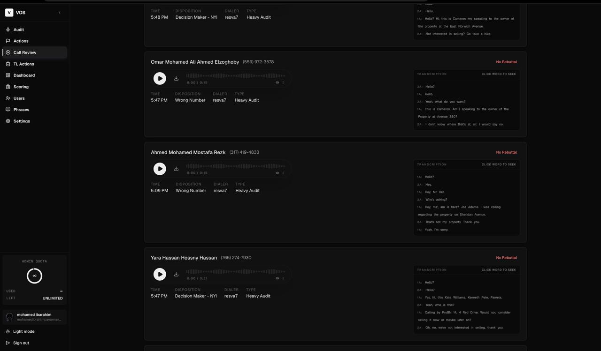
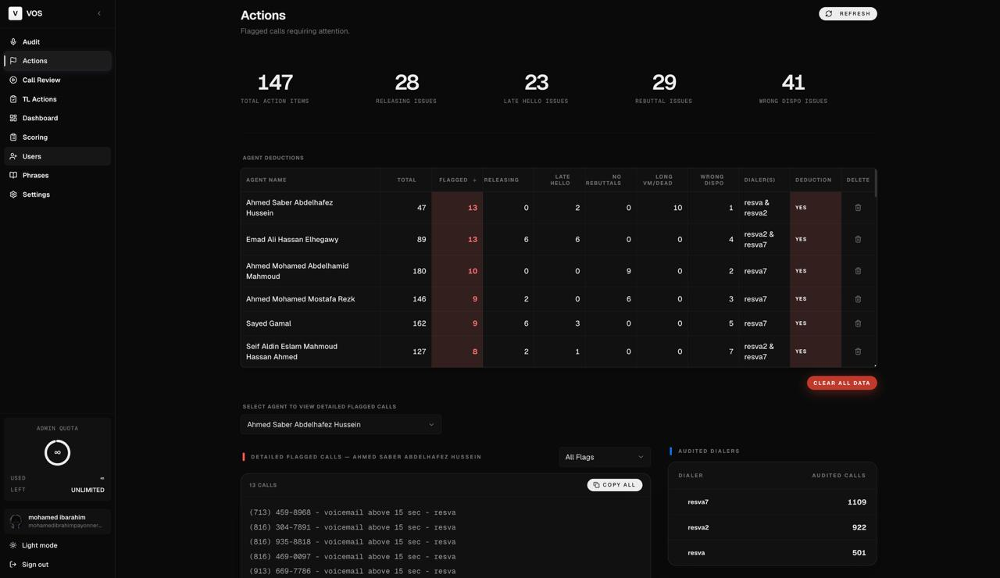
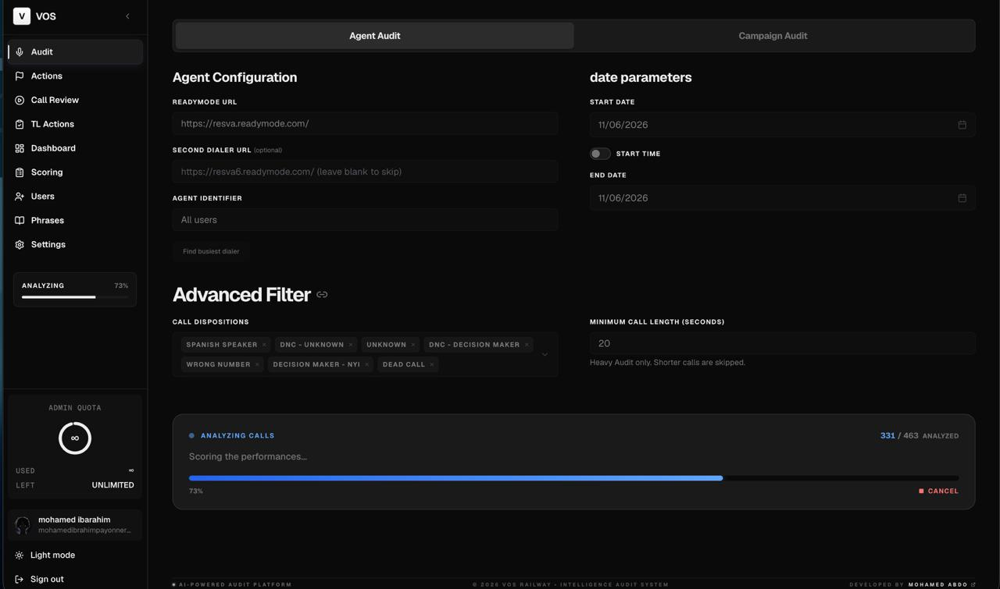
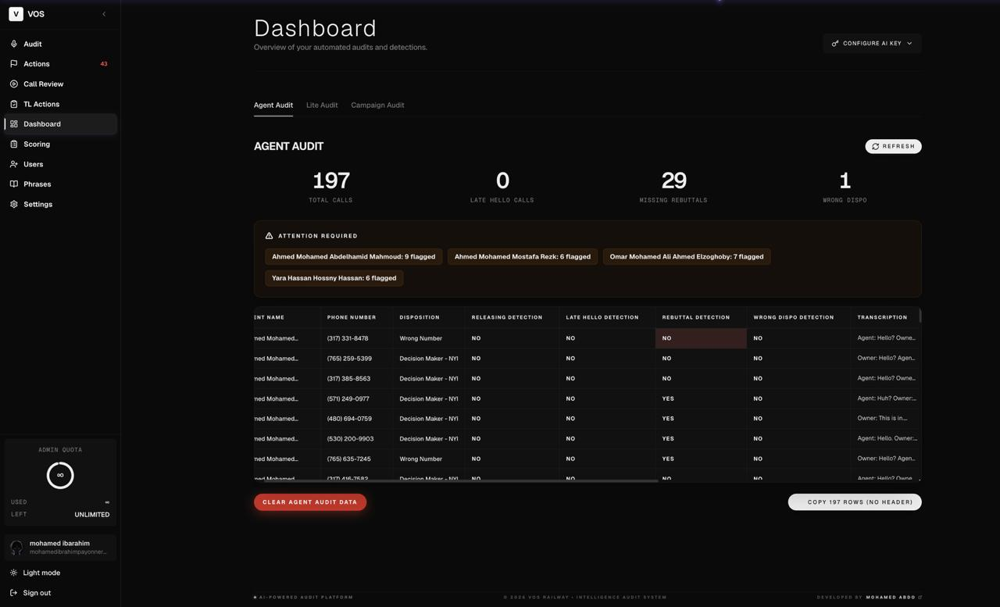
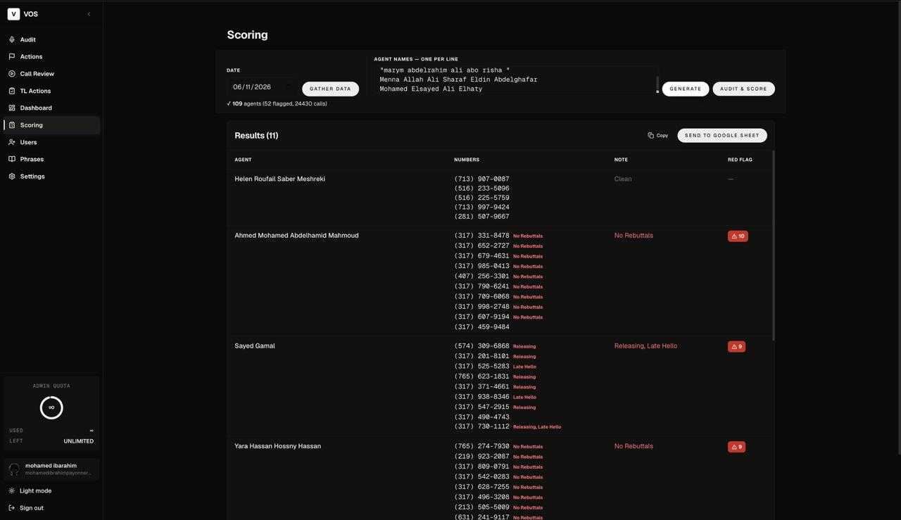
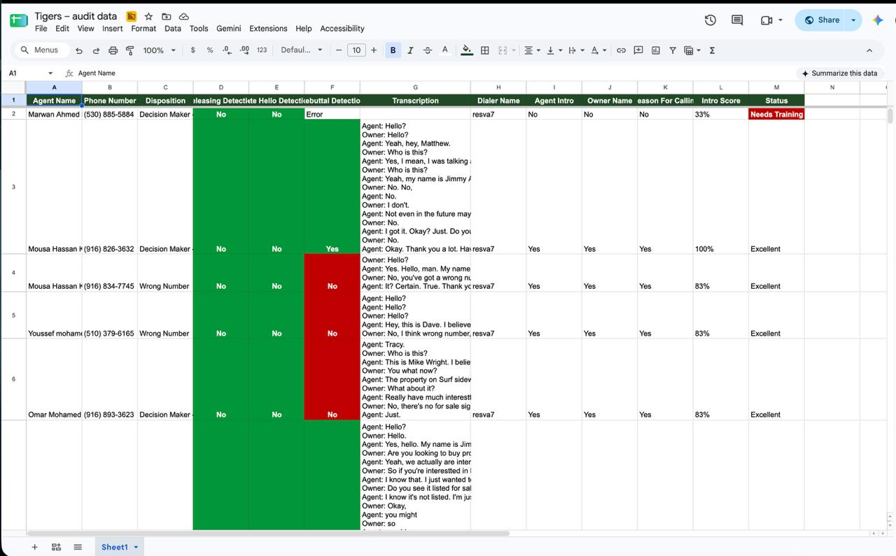
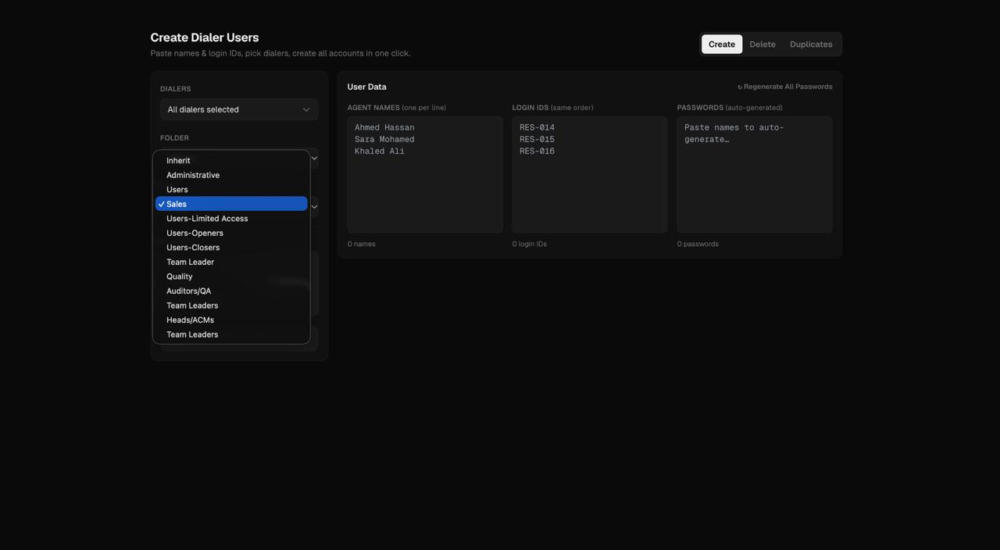
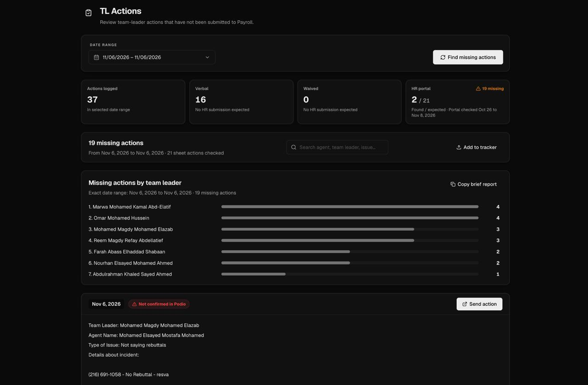
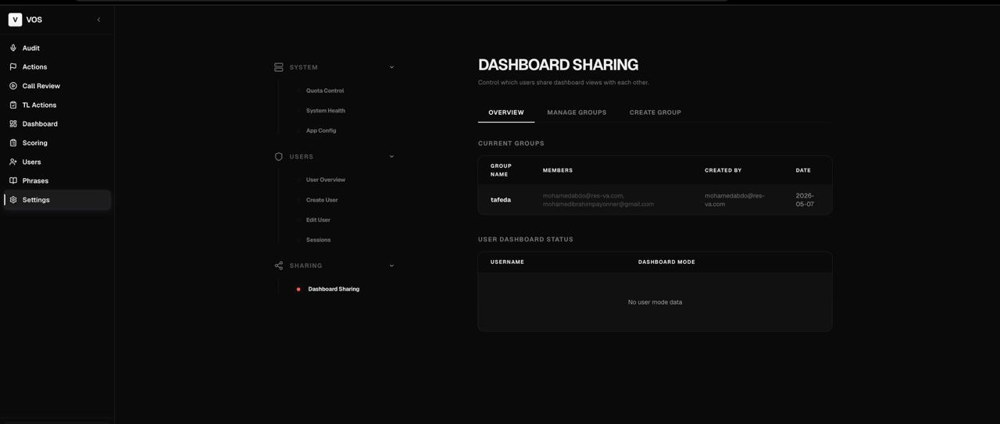

# VOS (Voice Observation System)

Call QA automation for Egyptian real estate sales teams. VOS pulls recordings from ReadyMode dialers, transcribes them, checks whether the agent answered the customer's objection, flags quality problems, and scores the audit.

Manual review of the same calls took about 45 seconds each.

## The pipeline, in one picture

```text
ReadyMode dialer ──┐
                    ├──> Audit page ──> AssemblyAI transcription ──> Detections ──> Flags
MP3 upload ────────┘                                                                  │
                                                                                        v
                                                              Actions queue <── flagged calls
                                                                    │
                                                                    v
                                                    Call Review (listen + see why it flagged)
                                                                    │
                            ┌───────────────────────────────────────┼──────────────────────┐
                            v                                       v                      v
                   Agent / Lite / Campaign                  Scoring ("Audit & Score")  Campaign Reports
                        Dashboards                              → Google Sheet          → Sheet + Doc
```

Everything below explains one box at a time.

## 1. Call auditing & rebuttal detection

A **rebuttal** is just: the customer raised an objection ("too expensive", "I'm not interested", "let me think about it"), and did the agent actually respond to it instead of going silent or changing the subject? VOS has to answer that for every call, in plain English, without a human listening to it.

**Step 0 — transcription.** AssemblyAI turns the audio into text with separate speaker tracks (agent vs. customer), so VOS knows who said what. Egyptian-accented English trips up transcription in predictable ways (certain words get swapped for similar-sounding ones), so `lib/egyptian_accent_correction.py` fixes those known errors before anything else runs.

Then the transcript goes through up to three stages. Each stage only runs if the one before it couldn't decide with confidence — most calls stop after stage 1.

**Stage 1 — exact & pattern matching.** VOS keeps a library of 2,000+ known rebuttal phrases (`rebuttal_phrases.txt`), grouped by category (price, timeline, trust, competing properties, etc.). It checks the agent's words after the objection against that list, plus a set of flexible regex patterns for phrasing the fixed list doesn't cover word-for-word.
- *Example:* customer says "I found a place 20% cheaper elsewhere." Agent says "I found a place cheaper" is in the library → instant match, confidence 1.00, done. Takes ~0.2 seconds, costs nothing.

**Stage 2 — semantic matching.** If nothing matched exactly, VOS encodes the agent's sentence into a vector (via sentence-transformers, running locally) and compares it to the same phrase library by *meaning* rather than exact wording. A similarity score above ~0.68 counts as a match.
- *Example:* customer worries the area is "too noisy." Agent never says a phrase from the library verbatim, but says something close enough in meaning to "Is the neighborhood quiet?" (similarity 0.65 in this case) — close, but not quite confident enough on its own, so it moves to stage 3.

**Stage 3 — LLM verification.** Only for the genuinely ambiguous cases. VOS sends the exchange to Groq (Llama 3.3 70B) with the full conversation context and asks it to judge like a sales coach would. The LLM has the final say — it can confirm a shaky match *or* overrule it and clear it if it decides there was no real rebuttal.
- *Example continued:* the LLM reads "customer is worried about noise and resale value" and reasons that's a real objection about the property, not small talk — confidence 0.85, rebuttal confirmed.

**Why three stages instead of one:** doing an LLM call on every single response would be accurate but slow and expensive. Running exact-match first and only escalating when needed means roughly 80% of calls never need the expensive step. On 1,000 calls that's the difference between ~$2–3 and ~$15–20, and about 2.5 hours instead of 12.5.

**Auto-learning:** when stage 2 or 3 finds a real rebuttal that wasn't in the phrase library, VOS records it as a "learned phrase." High-confidence ones get added automatically; anything less certain goes to the **Phrases page** (Owner-only) for a human to approve or reject. This is how the library grows past 2,000 phrases over time instead of needing someone to maintain it by hand.



## 2. Late Hello & Releasing detection

These two checks never look at the transcript at all — they analyze the raw audio waveform on the agent's side of the call. That matters because a transcript can't tell you "the agent didn't say anything," only silence can.

**How it tells speech from background noise:** VOS measures the agent channel's energy level (loudness), zero-crossing rate (how often the waveform flips sign — a decent proxy for whether something is actual voice vs. a tone or hum), and a few spectral features (does the sound sit in the frequency range a human voice occupies). A short clip only counts as "speech" if it passes several of these checks together, not just one — that's what keeps a loud cough or a click on the line from being mistaken for talking.

**Releasing** — "Yes" if the agent's side of the call has *zero* detected speech for the entire call. In practice this usually means the agent muted themselves, put the call down, or walked away while it was still connected.

**Late Hello** — "Yes" if the agent's *first* detected speech comes more than 5 seconds (configurable) after the call connects. That's the "the customer had to say hello first" problem — the agent was slow to pick up or distracted.

*Example:* a 90-second call where the agent channel has no speech at all → Releasing = Yes. A call where the agent's first word lands at 7.2 seconds in → Late Hello = Yes. A call where the agent says "Hi, this is Ahmed calling about—" at 1.1 seconds → both are No.



## 3. The auditing workflow

This is the path a batch of calls actually takes through the app:

1. **Audit page** — pull recordings straight from a ReadyMode dialer (pick the dialer, a date, optionally a campaign) or upload MP3 files directly if you already have them. No browser automation involved — VOS talks to ReadyMode over plain HTTP (`automation/readymode_http.py`), which is faster and doesn't need a browser running.
2. **Processing** — every call goes through transcription and all the detections above, in parallel batches.
3. **Actions page** — the queue of calls that tripped a flag: Late Hello, Releasing, No Rebuttal, agent-only (customer never spoke — likely a wrong number or voicemail), or a long/dead call. This is the triage list an auditor actually works from.
4. **Call Review page** — pick a flagged call and get the audio player next to the transcript and the specific reason it flagged (e.g., "LLM identified a rebuttal attempt" or "no speech detected in agent channel"), so you don't have to re-derive why VOS flagged it.



## 4. Dashboard & reporting

Three dashboard views, for three different jobs:

- **Agent Audit Dashboard** — the full, detailed history for every agent: every call audited, every flag, trends over time. This is the "heavy audit" view.
- **Lite Audit Dashboard** — a faster, lighter scan focused on reachability and dispositions (did the call connect, what was the outcome) rather than full quality scoring. Useful for a quick campaign health check without running every detection on every call.
- **Campaign Audit Dashboard** — rolls results up by campaign instead of by agent, for comparing how different campaigns are performing.



## 5. Scoring system ("Audit & Score")

This is the one-click version of what a human QA auditor does with a spreadsheet, built around the company's existing "Auditors-Scoring" sheet format:

1. **Gather** — pull the phone-number-to-agent list from every dialer for a chosen date, plus that date's already-flagged calls, and cache both.
2. **Generate** — for each agent, take up to 5 fresh call samples (preferring their flagged calls where they have them, otherwise random ones) and turn the detections into a single score per agent by **majority vote** across five points: late hello, releasing, used a rebuttal correctly, gave a proper intro, and stated the reason for calling. If an agent doesn't have 5 real samples, the phone-number cell gets padded with unused numbers from their list just so the sheet looks complete — padded numbers are never scored.
3. **Export** — push the generated rows straight into the shared Google Sheet, in the exact column layout the scoring team already uses.

The rebuttal column is deliberately stricter than the others: it's only flagged as an issue when a *full* set of 5 samples was scored and fewer than 2 of them used a rebuttal — a thin sample (fewer than 5 calls) is never used to judge rebuttal use, since not every call needs one.



## 6. Campaign reports

A one-click export: pick a campaign and a date range, and VOS generates a Google Sheet and a Google Doc summarizing that campaign's results, using the user's connected Google Workspace account. If they haven't connected Google yet, the request comes back asking them to do that first instead of silently failing.



## 7. User management

Three roles, in a strict hierarchy: **Owner → Admin → Auditor.**

- An Admin only ever sees the Auditor accounts they personally created — not every user in the system.
- Daily call quotas cascade the same way: the Owner sets how much quota each Admin gets, each Admin splits that between the Auditors they manage. The Owner's own account always gets effectively unlimited quota.
- Each user account carries its own ReadyMode dialer login and, optionally, its own AssemblyAI transcription key, so usage and billing can be tracked per person if needed.

**Bulk dialer user creation** is the part that actually saves hours: instead of logging into each ReadyMode dialer and creating accounts one at a time, you paste a list of names and login IDs, pick which dialers they should exist on, and hit one button. VOS creates every account across every selected dialer and streams the result back live (so you see each one succeed or fail as it happens, not just a spinner until the whole batch is done). The same screen also handles bulk delete and finding duplicate/inactive accounts across dialers. A batch that used to take hours of manual clicking typically finishes in about a minute.



## 8. Team Leader & HR features (TL Actions)

When an agent gets flagged enough to warrant a real consequence (a warning, a deduction, coaching), that's supposed to be logged as a formal "TL Action" by their Team Leader — not just noted inside VOS. This section exists because that paper trail kept going missing, and someone had to manually cross-check three different spreadsheets to find the gaps.

- **Tracker** — lets an Admin/Owner append actions (date, team leader, details) straight into the shared tracking spreadsheet used company-wide.
- **Reconciliation** — the read-only check: it compares the TL Actions sheet against the Payroll system's recorded deductions and a separate "Audit Reply" waiver sheet (for actions that were formally excused), for a date range, and surfaces any action that's missing from where it should be.
- **Submission** — for a missing action, VOS builds a pre-filled link (a Podio webform, or a Google Form as a fallback) so the responsible Team Leader can formally submit the paperwork in one click instead of starting from a blank form.
- **Podio integration** — once the company's Podio account is connected (OAuth), VOS can confirm a submission actually landed in Podio rather than someone saying "I submitted it" with no record.



## 9. Phrase management

Owner-only. This is where the rebuttal phrase library (see section 1) gets curated:

- **Pending phrases** — things stage 2 or 3 flagged as likely-new rebuttals that weren't confident enough to auto-approve. The Owner reviews each one and approves or rejects it.
- **Repository** — the full approved phrase list, browsable and editable.
- **Blacklist** — phrases explicitly rejected so they stop coming back up for review.

## 10. Settings, quotas & sharing

- **Settings page** — a user's own profile, daily call limit, ReadyMode credentials, personal AssemblyAI key, and (for Admin/Owner) system health checks.
- **Quota redistribution** — an Admin can rebalance daily quota across the Auditors they manage without the Owner having to do it; the Owner sets the overall limits each Admin works within.
- **Sharing groups** — by default every user's dashboard is isolated to their own audits. An Admin can put a group of users into a shared dashboard mode so a team sees one combined view instead of everyone's data staying siloed.



## Screenshots

The images above live in [`screenshots/`](screenshots/), one subfolder per feature. See [`screenshots/README.md`](screenshots/README.md) if a shot ever needs retaking — it says what to capture for each one and where to save it.
